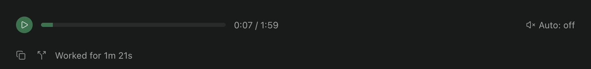
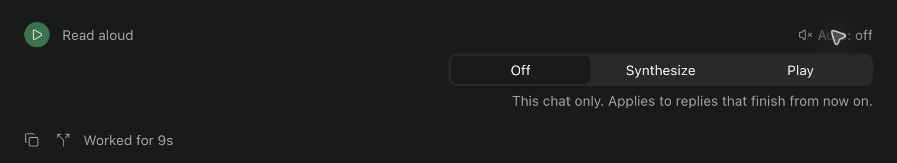
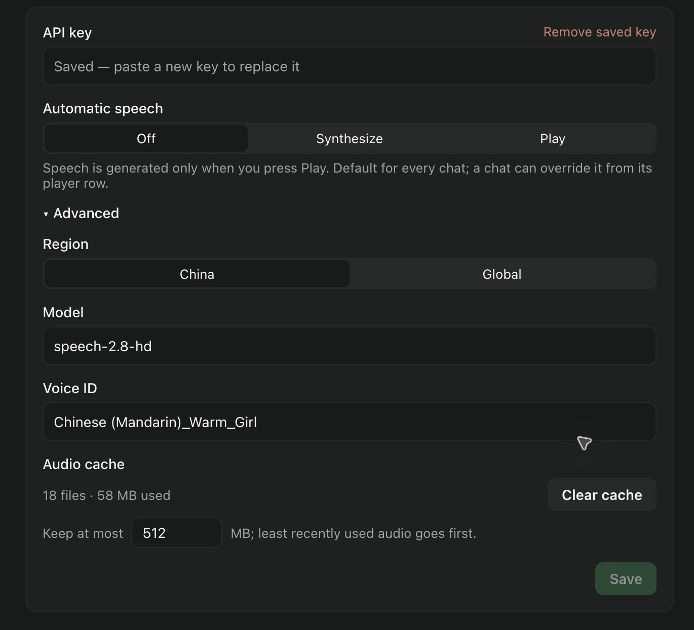

# Paseo MiniMax TTS

[English](README.md)

一个极简 [Paseo](https://paseo.sh) 插件：将 Agent 一轮结束后的最后一条助手回复交给 [MiniMax](https://www.minimax.io) 合成，在聊天页每条最终回复下方的内嵌播放器中播放。当前是早期版本，不是内置 Voice Mode 的替代品。

非官方项目，与 MiniMax、Paseo 均无关联。

## 界面一览

**在回复下方直接听。** 点击播放即可朗读最终回复，随时暂停，也可以拖动进度条跳到想听的位置。图中暂停在 0:07。



**每个聊天单独设置自动语音。** 展开 **Auto**，可选择手动播放（Off）、提前合成（Synthesize）或自动播放新回复（Play）。



**切换页面也能控制播放。** 侧栏显示音频所属的聊天，提供继续和停止按钮；点击标题即可回到该聊天。


以上均为 macOS 上 Paseo 网页端的实际截图，裁剪后聚焦于插件控件。

## 功能

- 全局“正在朗读”控制：有音频加载且未播完时，侧栏底部会出现一行，显示聊天标题，并带暂停/继续和停止按钮；点击这一行会跳转到音频所属的聊天，用那里的进度条（只能打开聊天，没法滚动到具体那条回复）。停止会结束当前音频并清空排队中的自动播放回复，所以在任何页面都能让声音停下。归档或删除聊天会自动停掉它的音频并丢弃它排队的回复。
- 聊天页内嵌播放器：每轮结束后在最终回复下方出现一行，可合成、播放、暂停/继续、拖动进度条定位、取消合成。
- 设置页配置 API key、国内/国际区域、模型与音色。
- 自动语音三档，默认关闭：Off 仅手动；Synthesize 回复结束时由 daemon 立即合成并缓存，点 Play 即播；Play 在合成后自动播放。可设全局默认，也可在任一聊天的播放器行用 **Auto** 单独覆盖。播放器行会标出状态：Read aloud（点播放时才合成）、Synthesizing…（正在合成）、Ready（已缓存，点播放即播）、Expired（回复已不在内存中，无法再播）。
- 合成不限长度，长回复分段合成后合并；设置页可设置缓存上限并清空缓存。
- 仅在成功完成的轮次中选择最后一条助手消息，不拼接工具调用、思考过程或中间助手消息。

## 要求与安装

需要 Paseo 0.11.4 或更新版本，开发与验证均在 0.11.4 的网页端完成。桌面/web 使用浏览器音频实现；原生 iOS/Android 播放暂不支持。另外需要自己的 MiniMax API 密钥，合成费用记在你的 MiniMax 账户上。

插件是可信、非沙箱代码。先审查源码，并在目标 daemon 中允许插件，然后：

```sh
paseo plugin install github:wangfh5/paseo-minimax-tts
paseo plugin ls
```

更新用 `paseo plugin update paseo-minimax-tts`。如果想基于本地源码开发：

```sh
npm ci
npm run typecheck
npm test
paseo plugin install /absolute/path/to/paseo-minimax-tts
```

源码更新后运行 `paseo plugin reload paseo-minimax-tts`，不需要重启 daemon。

## 使用

1. 在 Paseo 的 **Settings → Plugins** 中点击 paseo-minimax-tts 右侧的 **…** 菜单，选择 **Settings** 打开设置页，也可以在命令面板（⌘K）搜索 **MiniMax speech settings**。
2. 在设置页填写密钥，选择与密钥匹配的区域，点击 **Save**。
3. 完成一轮新的 Agent 对话，在聊天页该回复下方的播放器行点击 **Play**。
4. 浏览器若阻止自动播放，点击 **Play**。
5. 需要自动朗读时，在设置页把 **Automatic speech** 选为 Synthesize 或 Play 并保存；区域、模型、音色收在 **Advanced** 中。只想对某个聊天开启或关闭，点该聊天播放器行右侧的 **Auto**，选 Off / Synthesize / Play，仅对之后结束的回复生效；未单独设置的聊天沿用全局默认。

设置页集中管理密钥、全局自动语音模式、区域、模型、音色与音频缓存。下图已展开 **Advanced**；已保存的密钥不会回显。



默认模型为 `speech-2.8-hd`，音色为 `Chinese (Mandarin)_Warm_Girl`，区域为 `cn`。密钥由用户提供。国内订阅密钥与按量付费密钥的额度不同，请使用与账户及接口匹配的密钥。

## 隐私与存储

- MiniMax 请求只由 daemon 发起，选中的回复文本会发送到对应区域的 MiniMax API，消耗该账户额度。
- 密钥与设置存于 daemon 用户的 `~/.paseo-minimax-tts/settings.json`，目录权限 `0700`、文件权限 `0600`；这是受文件权限保护的明文存储，不是加密保险库，Windows 上不会强制这些权限。
- 设置读取 RPC 只返回是否已有密钥，不返回密钥内容。输入框留空会保留旧密钥，也可删除密钥。
- 密钥、设置、生成的音频和 node_modules 不应提交 Git。
- 最近 20 条回复文本仅在 daemon 内存中保存，重载/重启即清空。
- 合成出的音频缓存为磁盘文件，位于 `~/.paseo-minimax-tts/audio/`（目录 `0700`、文件 `0600`，文件名为哈希，同样是明文 MP3，不加密），已合成过的回复再次播放不会重复计费，插件重载后也一样，因为聊天里的播放器行仍在。daemon 重启会清掉播放器行和回复列表，更早的缓存音频就无法再从聊天中访问，只会随缓存淘汰。总量上限默认 512 MB，可在设置页的 **Audio cache** 修改，设置页也显示当前占用并可手动清空；超出上限后淘汰最久未使用的文件，调低上限会立即生效；上限是硬限制，单条音频本身超过上限时不会被缓存（之后再播要重新合成并计费）；缓存键包含模型和音色，改了音色就会重新合成。不再需要时可直接删除该目录。回复文本已不在内存、音频也被淘汰时，无法再次合成。

## 当前限制

- 播放器行是独立的插件时间线行，位于回复下方，不在消息气泡内；它存放在 daemon 的内存时间线中，daemon 重启后消失。全局只有一个音频，同时只能播放一条。
- Paseo SDK 没有统一 final/channel 标记；采取“成功结束且最后的有效消息是助手文本”的保守规则。分多条发送的最终答案只读最后一条，不能区分语义上类似最终答案的结束评论。
- 自动语音的全局默认是 daemon 共享设置，不是按设备设置；聊天级覆盖按 Agent 保存在同一个设置文件中，可在该聊天的播放器行修改，但要等该聊天出现第一条回复后才有入口。Synthesize 与 Play 都会在 daemon 里自动合成并计费，即使没有任何客户端在听。多个客户端可能同时发声。
- 自动播放在 Paseo App 打开且插件已加载时运行。新的自动播放回复按完成顺序排队，等当前音频播完再依次播放；暂停中的音频会让队列等待，出错的音频不会。初始/重连快照不补播。队列只在客户端内存中。
- 浏览器自动播放策略、后台挂起或关闭 App 可能阻止播放。
- 合成不限长度：超过 2,000 字符的回复会按段落、句子边界切成多段依次请求 MiniMax（它对单次请求的上限是不到 10,000 字符），再把各段 MP3 按顺序拼成一个文件。费用随字数增加，自动模式不会再因为太长而拒绝。每次请求超时 60 秒，可随时取消。已合成完的分段会先单独缓存，中途失败后重试只合成剩下的部分，全部完成后再合并存为整条并删除分段。
- 仅在 macOS 上、Paseo 0.11.4 的网页端、国内区域实测过；国际区域只有模拟请求的测试。
- `npm audit` 有上游告警，来自 `react-native` 的开发工具链；插件本身不带运行时依赖。

## 开发与验证

```sh
npm run typecheck
npm test
# 本机只读 RPC 检查，无密钥回显，不合成音频
npx tsx server/rpc-check.ts ws://127.0.0.1:6767/ws
# 明确触发付费合成：需要已经完成一轮新回复
npx tsx server/rpc-check.ts ws://127.0.0.1:6767/ws --synthesize-latest
```

测试覆盖最终消息选择、设置存储与迁移、模拟 MiniMax 请求、文本切分与 MP3 拼接、磁盘缓存（上限、淘汰、并发）、自动播放队列、播放器状态与拖动定位以及原生端隔离。上述 RPC 合成命令本身不播放声音。做 UI 播放测试前应提醒使用者，避免其他已连接设备突然出声。

目录：`client/` 为 UI 与播放器，`server/` 为凭据存储、回复筛选、缓存及 MiniMax 请求，`shared/` 为 RPC 契约。`OVERVIEW.md` 为 Paseo 内插件说明。

## 许可证

[MIT](LICENSE)
